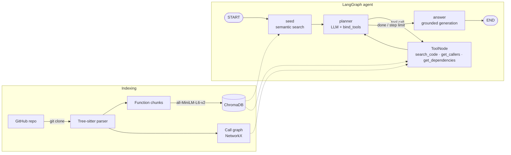

# Codebase Intelligence Agent

**A LangGraph agent that answers questions about any GitHub codebase by combining semantic code search with a call graph (GraphRAG).**

Paste a public GitHub link, and the system clones the repository, parses every function with Tree-sitter, embeds them into a vector store and builds a call graph. A LangGraph agent then answers questions by deciding which tools to use (search the code, find a function's callers, find what it calls) and writes an answer grounded only in the code it retrieved. A benchmark measures the agent against plain vector RAG, graph-expanded RAG and a hand-written agent baseline.

**Stack:** Python · LangGraph · LangChain · Google Gemini / Ollama (Llama 3.1) · ChromaDB · Sentence Transformers · Tree-sitter · NetworkX · Streamlit

---

## Highlights

- **LangGraph agent with native tool calling:** a `StateGraph` with typed state, a tool-calling planner (`bind_tools`), the prebuilt `ToolNode`, conditional routing and a step limit.
- **GraphRAG over code:** function-level chunks in ChromaDB plus a static call graph, so the agent can follow how code connects, not just find text that looks similar.
- **Works on any C, C++ or Python repository:** shallow clone, Tree-sitter parsing and indexing in seconds (Lua: 68 files, 1,297 functions, about 15 s on a laptop).
- **Language-aware call resolution:** C++ qualified names and macros; Python `Class.method` naming, `self.method()` calls, and filtering of ambiguous `obj.method()` calls.
- **Measured results:** on a 26-question benchmark, the LangGraph agent reaches **100% retrieval recall and 95% answer fact recall**, compared with 84% / 79% for vector RAG. Most of the gain is on caller, dependency and multi-hop questions ([Results](#results)).
- **Interactive UI:** chat with live agent steps, the functions behind each answer, and an explorable call graph.
- **Pluggable LLM:** one setting switches between Google Gemini (cloud) and Ollama (local).

---

## Architecture



### The LangGraph agent (`agent_langgraph.py`)

| Part | What it does |
|---|---|
| **State** (`AgentState`) | Typed dict shared by all nodes: question, message history (appended with the `add_messages` reducer), functions found, step count, final answer. |
| **`seed` node** | Runs semantic search on the question, so the planner starts with function names that actually exist in the repo. |
| **`planner` node** | Gemini or Llama 3.1 with the three tools bound through native tool calling. Returns a structured tool call, or finishes when it has enough evidence. |
| **Conditional edge** | Goes to `tools` when the planner requested a tool, or to `answer` when it is finished or has reached the step limit (5). |
| **`tools` node** | LangGraph's prebuilt `ToolNode`. Tool errors go back to the model as messages instead of crashing the run. |
| **`answer` node** | Writes the final answer using only the collected observations, and says so when they are insufficient. |

The tools return `content_and_artifact`: the LLM sees the source code, while the IDs of the functions retrieved travel separately as artifacts. The UI and the benchmark use those IDs without adding them to the model's context.

**Tools available to the agent:**
- `search_code(function_name)`: source of a function, with a fallback to semantic search when no function has that name
- `get_callers(function_name)`: functions that call it, with their source
- `get_dependencies(function_name)`: functions it calls, with their source

### Indexing and GraphRAG (`indexer.py`)

1. **Parse:** Tree-sitter turns every `.c/.cpp/.h/.py` file into a syntax tree. Vendored and generated folders are skipped.
2. **Chunk:** each function becomes one retrieval unit with a stable ID such as `requests/src/requests/sessions.py::Session.send`.
3. **Embed:** `all-MiniLM-L6-v2` embeddings of name and code, batched into ChromaDB.
4. **Link:** in a second pass, every call inside a function is resolved against the repository's own functions, which builds a directed call graph. Library calls are ignored.
   - **C/C++:** names are read from the syntax tree, which handles `Foo::bar`, pointer return types and export macros. A definition in the same file is preferred when names collide.
   - **Python:** `foo()` links to functions, and `self.foo()` / `cls.foo()` to methods. `obj.foo()` is linked only when the method name is unique in the repo and is not a built-in `dict`/`list`/`str` method name.

---

## Results

Benchmark of 26 questions on the bundled C++ client/server repository, with all systems using `gemini-3.5-flash` (single run, November 2026, [raw results](eval/results/run-gemini-3.5-flash-20261110-153317.json)).

| System | Retrieval recall | Fact recall | Fully correct* | Avg context (chars) | Avg latency |
|---|---|---|---|---|---|
| Vector RAG | 84% | 79% | 17 / 26 | 3,753 | 5.0 s |
| Graph RAG (1-hop) | 94% | 92% | 22 / 26 | 10,952 | 5.2 s |
| Baseline agent (hand-written loop) | 98% | 94% | 20 / 26 | 5,422 | 10.0 s |
| **LangGraph agent** | **100%** | **95%** | **23 / 26** | 7,108 | 9.4 s |

\* Fully correct means all expected functions were retrieved and all expected facts appear in the answer.

**Retrieval recall / fact recall by question type:**

| Category (questions) | Vector RAG | Graph RAG | Baseline agent | LangGraph agent |
|---|---|---|---|---|
| Lookup (6) | 100% / 92% | 100% / 86% | 100% / 81% | 100% / 86% |
| Conceptual (9) | 100% / 94% | 100% / 100% | 100% / 94% | 100% / 94% |
| Callers (4) | 62% / 38% | 100% / 100% | 100% / 100% | 100% / 100% |
| Dependencies (2) | 50% / 50% | 50% / 50% | 83% / 100% | 100% / 100% |
| Multi-hop (5) | 65% / 79% | 90% / 95% | 95% / 100% | 100% / 100% |

**What the numbers show:**
- **The LangGraph agent retrieved every expected function** (100% retrieval recall), up from 84% for vector RAG, and fully answered 23 of 26 questions versus 17.
- **The gains come from structural questions.** On callers, dependencies and multi-hop questions, vector search alone reaches 50–65% retrieval, because "who calls X" cannot be answered by text similarity. The agent answers them by calling `get_callers` / `get_dependencies`.
- **It is selective.** Simple lookups are answered straight from the seed search. The agent used tools on 17 of 26 questions (2.2 planner steps on average) and stopped on its own in 25 of 26 runs.
- **Targeted retrieval uses less context than blind expansion.** It achieves higher recall than 1-hop Graph RAG with 35% less context (7.1k vs 11.0k characters), because it fetches only the neighbours it needs.
- **The cost is latency.** About 9 s per question versus 5 s for single-shot RAG, because of the extra planner calls.
- **LangGraph vs the hand-written loop:** with the same tools and model, the two score close (100% vs 98% retrieval). The LangGraph version uses native tool calling instead of parsing text, and calls tools more often (17 vs 10 questions).

These figures come from a single run on a small benchmark; differences of a few points are within run-to-run noise (see [Limitations](#limitations)).

---

## Quick start

```bash
git clone https://github.com/Kushal-2002/Codebase-Intelligent-Agent.git
cd Codebase-Intelligent-Agent
python -m venv .venv && source .venv/bin/activate
pip install -r requirements.txt

cp .env.example .env          # add your GOOGLE_API_KEY
streamlit run app.py
```

Open http://localhost:8501, paste a GitHub link (for example `https://github.com/psf/requests`) in the sidebar, click **Load repository**, and ask questions.

**Command line:**

```bash
python agent_langgraph.py            # ask a question about the bundled sample repo
python agent_langgraph.py --diagram  # print the LangGraph graph as Mermaid
python ingest.py                     # rebuild the index for the bundled sample repo
```

### Choosing the LLM

All LLM calls go through `llm.py`, configured in `.env`:

| Setting | Values | Default |
|---|---|---|
| `LLM_PROVIDER` | `gemini`, `ollama` | `ollama` |
| `LLM_MODEL` | any model name | `gemini-3.5-flash` / `llama3.1` |
| `GOOGLE_API_KEY` | your Gemini API key | (none) |

For local models, run `ollama pull llama3.1`. The original `llama3` does not support tool calling in Ollama.

---

## Web interface

- **Repository sidebar:** load any public C, C++ or Python GitHub repository. Each one gets its own workspace (`workspaces/<owner>__<repo>/`) with a shallow clone, vector index, call graph and metadata. Previously indexed repos stay in a dropdown. The cloned code is only parsed, never built or run.
- **Chat:** shows the agent's tool calls live, then the answer with the **agent steps**, the **functions used** and a **call graph of those functions**.
- **Call graph explorer:** pick any function and see its callers and/or callees up to three levels out (capped at 60 nodes), coloured by file, with its source code.

---

## Evaluation

```bash
python eval/run_eval.py                                  # all systems, all questions
python eval/run_eval.py --systems langgraph,vector --ids q01,q07
python eval/run_eval.py --retrieval-only                 # retrieval metrics only, no LLM calls
```

**Systems compared:**

| System | Description |
|---|---|
| `vector` | Top-3 semantic search, then answer |
| `graph` | Top-3 semantic search plus one hop of callers and callees, then answer |
| `langgraph` | The LangGraph agent |
| `agent` | Baseline: the same tools in a hand-written loop with text-parsed tool calls (`agent.py`, `planner.py`) |

**Questions:** `eval/questions.json` has 26 questions about the bundled C++ client/server repository, in five categories: lookup, conceptual, callers, dependencies and multi-hop. Each question lists the functions that must be retrieved and the facts the answer must contain.

**Metrics:**
- **retrieval recall:** share of expected functions that were retrieved
- **fact recall:** share of expected facts that appear in the answer (case-insensitive keyword match)
- **latency** and **context size**

Per-question results are saved to `eval/results/`.

---

## Project structure

```
├── agent_langgraph.py     # LangGraph agent: state, nodes, tools, routing
├── llm.py                 # Gemini / Ollama switch (LangChain chat models)
├── tools.py               # Retrieval tools over the active repository index
├── indexer.py             # Tree-sitter parsing, embeddings, call graph
├── workspace.py           # Clone a GitHub repo and index it into workspaces/
├── app.py                 # Streamlit interface
├── graph_view.py          # Call graph subgraphs as Graphviz
├── eval/
│   ├── run_eval.py        # Benchmark runner
│   ├── questions.json     # 26 questions with expected functions and facts
│   └── results/           # Saved runs
├── agent.py, planner.py   # Baseline hand-written agent loop
├── ingest.py              # Index the bundled sample repo
├── repository/            # Bundled sample C++ repository used by the benchmark
└── data/                  # Call graph and function lookup for the sample repo
```

---

## Limitations

- **Static call graph:** function pointers, virtual dispatch, dynamic Python calls and heavy macro use can be missed or ambiguous.
- **No memory between questions:** each question starts a fresh agent run.
- **Small benchmark:** one small C++ repository, with keyword-based fact matching. Two identical functions in the sample repo tie in vector search, so results vary slightly between runs.
- **Languages:** C, C++ and Python only, and public repositories only.

## Roadmap

- Conversation memory with LangGraph checkpointing (follow-up questions)
- A self-check node that verifies answer claims against the retrieved code
- LLM-as-judge scoring and benchmark questions on larger Python repositories
- Tests and CI
- JavaScript/TypeScript, Java and Go support
